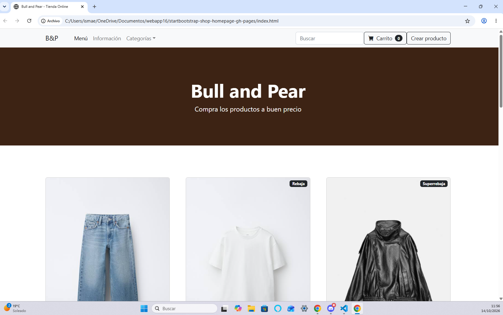
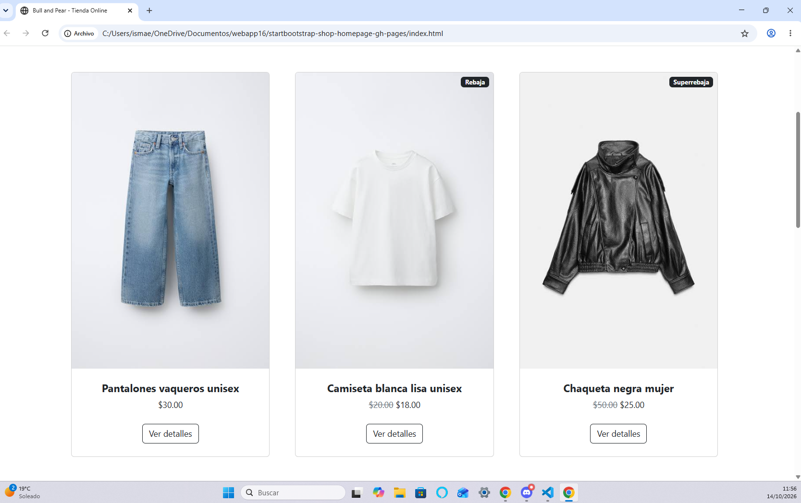
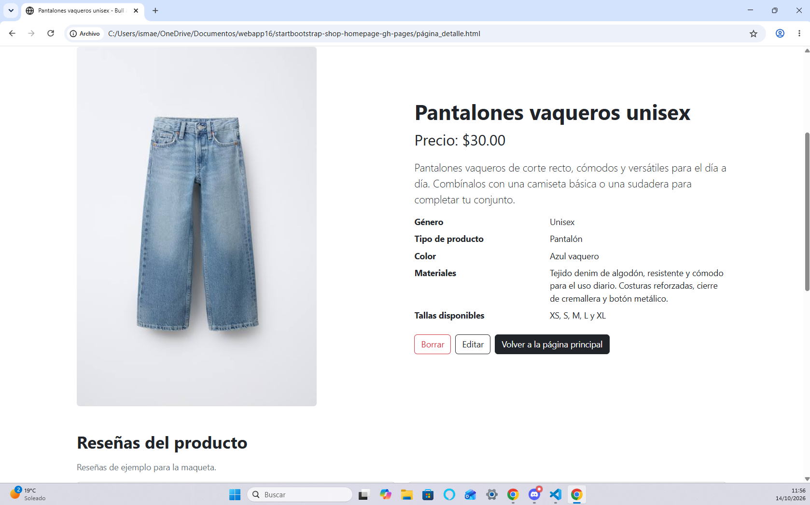
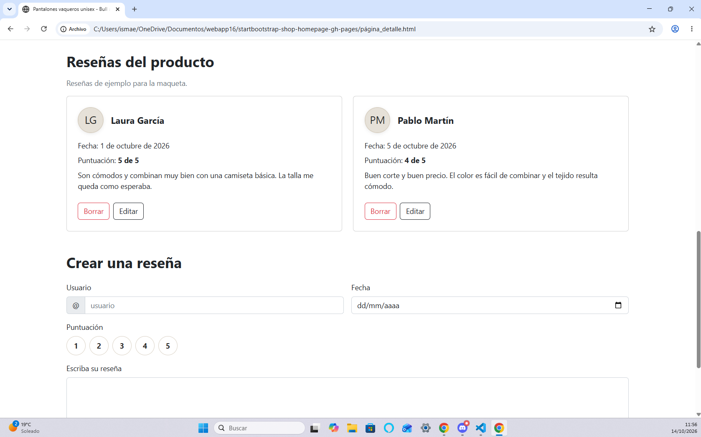
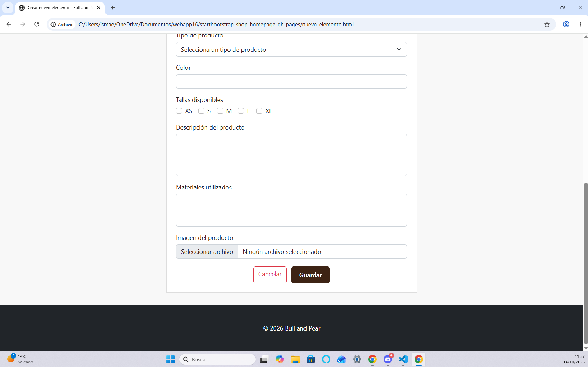
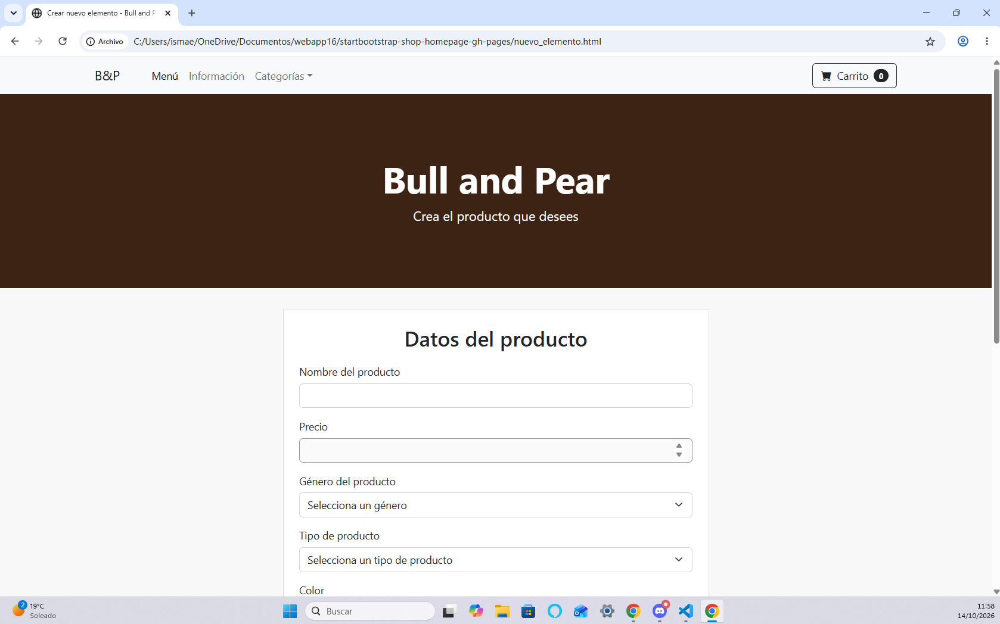

# webapp16
# Bull and Pear

## Integrantes del equipo

* **Ismael Sakhisada García**
  * **Correo URJC:** i.sakhisada.2025@alumnos.urjc.es
  * **GitHub:** [@Sakhii-007](https://github.com/Sakhii-007)

* **Diego Fernández Martín**
  * **Correo URJC:** d.fernandezma.2025@alumnos.urjc.es
  * **GitHub:** [@Diego-Fdzz](https://github.com/Diego-Fdzz)

* **Sergio Fernández González**
  * **Correo URJC:** s.fernandezgo.2025@alumnos.urjc.es
  * **GitHub:** [@SergioFernandezURJC](https://github.com/SergioFernandezURJC)

* **Alejandro Delgado Merino**
  * **Correo URJC:** a.delgadom.2025@alumnos.urjc.es
  * **GitHub:** [@laalooo](https://github.com/laalooo)
   ## Funcionalidad

### Entidades
* **Entidad Principal:**
   * Representa los productos textiles comercializados en la plataforma.
  * **Atributos:**
    * `Nombre` (Texto)
    * `Descripción` (Texto largo)
    * `Precio` (Número decimal)
    * `Género` (Selección: Hombre, Mujer, Unisex)
    * `Tipo de producto` (Selección: Camiseta, Pantalón, Chaqueta, etc.)
    * `Color` (Texto / Selección)
    * `Talla` (Selección: XS, S, M, L, XL)
    * 
* **Entidad Secundaria:** `Reseña`
  * Relacionada con cada producto para complementar la información del artículo.
  * **Atributos (Reseñas):**
    * `Autor` (Texto)
    * `Puntuación` (Número del 1 al 5)
    * `Comentario` (Texto)
    * `Fecha` (Fecha)
 
   
      
      ### Imágenes

* Cada producto de ropa de la entidad principal tendrá asociada al menos una imagen junto con su descripción.

### Filtrado

* **Filtrado múltiple:** Formulario de filtrado avanzado que permitirá organizar y encontrar productos según:
  * Género
  * Tipo de producto
  * Color
  * Rango de precio

  ## Práctica 1
  ### Imágenes de las páginas
  * **Página principal**:  

* **Página de detalle**:  

* **Página de nuevo elemento**:  

### Participaciones
* **Ismael:**
* He participado en la creación de la página principal y edición de la misma, modificando el grid dependiendo del tamaño de la pantalla. También he añadido la página de nuevo elemento em bruto para después corregir errores. Además de añadir la mayoria de imágenes

* Cinco commits más importantes

1. [Modificacion grid y cambios de estilo en la pagina principal](https://github.com/CodeURJC-FW-2026-27/webapp16/commit/ae25bc52b41a0e307c764525b3076abac77bb8d8)
2. [Creación página nuevo elemento](https://github.com/CodeURJC-FW-2026-27/webapp16/commit/71d3f1b17328c685f91d679d57e7d84512635a8e)
3. [Adición de colores en style.css](https://github.com/CodeURJC-FW-2026-27/webapp16/commit/b053ff84a1588810f0e4130615d23d1138d24e0f)
4. [Eliminación de código sobrante del boostrap](https://github.com/CodeURJC-FW-2026-27/webapp16/commit/984201bec7fd6b50f68b568bf2303faf08799b96)
5. [Corrección página nuevo elemento](https://github.com/CodeURJC-FW-2026-27/webapp16/commit/6ba4cfaf3b8b497f81ed2f42d19afd639672aec4)

* ficheros en los que participo

1. [index.html](https://github.com/CodeURJC-FW-2026-27/webapp16/blob/main/startbootstrap-shop-homepage-gh-pages/index.html)
2. [nuevo_elemento.html](https://github.com/CodeURJC-FW-2026-27/webapp16/blob/main/startbootstrap-shop-homepage-gh-pages/nuevo_elemento.html)
3. [página_detalle.html](https://github.com/CodeURJC-FW-2026-27/webapp16/blob/main/startbootstrap-shop-homepage-gh-pages/p%C3%A1gina_detalle.html)
4. [product-detail.css](https://github.com/CodeURJC-FW-2026-27/webapp16/blob/main/startbootstrap-shop-homepage-gh-pages/css/product-detail.css)
5. [styles.css](https://github.com/CodeURJC-FW-2026-27/webapp16/blob/main/startbootstrap-shop-homepage-gh-pages/css/styles.css)

* **Alejandro:**
* He participado en la creación de la página de detalle del producto y sus estilos CSS. También he completado el formulario de creación añadiendo desplegables para el tipo de producto y el género, un selector de imagen, un campo numérico para el precio y casillas para elegir varias tallas. Además, he corregido faltas de ortografía, traducido comentarios al inglés y actualizado los enlaces del catálogo para que apunten a la página de detalle.

* Cinco commits más importantes 

1. [Crear la página de detalle y sus estilos CSS](https://github.com/CodeURJC-FW-2026-27/webapp16/commit/99ad789ce5880c83ec6de69971de7339e1ec0f1e)
2. [Mejorar los campos de precio y tallas](https://github.com/CodeURJC-FW-2026-27/webapp16/commit/d85b65a454561c5487e22dbd735472c8152dc9d8)
3. [Añadir el selector de imagen](https://github.com/CodeURJC-FW-2026-27/webapp16/commit/6ae89f2871aa638c96a20234ffb54be8d9df4dae)
4. [Añadir la selección de género](https://github.com/CodeURJC-FW-2026-27/webapp16/commit/acceec269e04503ee1463067eb26466cda395170)
5. [Añadir el desplegable de tipo de producto](https://github.com/CodeURJC-FW-2026-27/webapp16/commit/6b017b11a829d8ecb59e07bdd9ee11c2a80c699f)

* ficheros en los que participo

1. [index.html](https://github.com/CodeURJC-FW-2026-27/webapp16/blob/main/startbootstrap-shop-homepage-gh-pages/index.html)
2. [nuevo_elemento.html](https://github.com/CodeURJC-FW-2026-27/webapp16/blob/main/startbootstrap-shop-homepage-gh-pages/nuevo_elemento.html)
3. [página_detalle.html](https://github.com/CodeURJC-FW-2026-27/webapp16/blob/main/startbootstrap-shop-homepage-gh-pages/p%C3%A1gina_detalle.html)
4. [product-detail.css](https://github.com/CodeURJC-FW-2026-27/webapp16/blob/main/startbootstrap-shop-homepage-gh-pages/css/product-detail.css)
5. [styles.css](https://github.com/CodeURJC-FW-2026-27/webapp16/blob/main/startbootstrap-shop-homepage-gh-pages/css/styles.css)

* **Sergio:**
* He participado en la catalogación,paginación,buscador y categorias,implementando en database.js y router.js las consultas a MongoDB con paginación (skip/limit de 6 en 6), búsqueda por nombre ($regex) y filtrado por categoría (Unisex, Hombre, Mujer).
También he adaptado views/index.html a Mustache (bucles {{#products}} y utilizado y adaptado con partials el index,controles de paginación, barra de búsqueda y enlaces de categorías).También cambié los checkbox de las tallas por botones.

* cinco commits
1. [creo el router.js](https://github.com/CodeURJC-FW-2026-27/webapp16/commit/453bfc30be5552de9948f917f4d6076a2102d8e0) 
2. [adapto app.js a router](https://github.com/CodeURJC-FW-2026-27/webapp16/commit/987e84761191d70b2a62e977345078cdc25f94a5)
3. [cambio database para el catalogo](https://github.com/CodeURJC-FW-2026-27/webapp16/commit/47e15c1785d1f0097450ad1666e805e59aff0651)
4. [cambio los html(partials) y corrijo router,js](https://github.com/CodeURJC-FW-2026-27/webapp16/commit/0e1c744c4f08e0adfe2c07fa17f7890743943878)
5. [correccion buscador filtro](https://github.com/CodeURJC-FW-2026-27/webapp16/commit/37f1864195cf66b3665bb301bce8e78a3dd7e122)

* ficheros en los que participo

1. [database.js](https://github.com/CodeURJC-FW-2026-27/webapp16/blob/main/src/database.js)
2. [router.js](https://github.com/CodeURJC-FW-2026-27/webapp16/blob/main/src/router.js)
3. [app.js](https://github.com/CodeURJC-FW-2026-27/webapp16/blob/main/src/app.js)
4. [product-detail.css](https://github.com/CodeURJC-FW-2026-27/webapp16/blob/main/public/css/product-detail.css)
5. [product-form.css](https://github.com/CodeURJC-FW-2026-27/webapp16/blob/main/public/css/product-form.css)
6. [index.html](https://github.com/CodeURJC-FW-2026-27/webapp16/blob/main/views/index.html)
7. [header.html](https://github.com/CodeURJC-FW-2026-27/webapp16/blob/main/views/partials/header.html)
8. [footer.html](https://github.com/CodeURJC-FW-2026-27/webapp16/blob/main/views/partials/footer.html)

### Diego Fernández

* **Diego:**
* He participado en la página de detalle del producto y en la gestión completa de las reseñas. He adaptado la vista de detalle a Mustache para que muestre de forma dinámica los datos de cada producto y su lista de reseñas, usando la cabecera y el pie comunes de la aplicación. He implementado en MongoDB las operaciones para crear, editar y borrar reseñas dentro de cada producto mediante `$push`, `$set` y `$pull`, asignando a cada reseña su propio identificador, junto con sus rutas en el router. También he creado la vista de edición de reseñas y un formulario compartido para crear y editar, y he añadido las validaciones tanto en HTML como en el servidor (campos obligatorios, longitudes, puntuación entre 1 y 5 y fecha no posterior a hoy), mostrando los errores y las confirmaciones en la página común de mensajes con un enlace para volver al formulario o al producto.

* Cinco commits más importantes

1. [Añadir funciones de reseñas en la base de datos e ids a las reseñas](https://github.com/CodeURJC-FW-2026-27/webapp16/commit/75def29140aeb1b33fa9bc3c12351b7efcf538dd)
2. [Añadir página de detalle de producto dinámica](https://github.com/CodeURJC-FW-2026-27/webapp16/commit/d791e14ddd6a95e157303ca1b556759c4b27a794)
3. [Añadir creación de reseñas con validación en servidor](https://github.com/CodeURJC-FW-2026-27/webapp16/commit/3284fcc71910f502005cef31fecf954674b4ac96)
4. [Añadir edición de reseñas](https://github.com/CodeURJC-FW-2026-27/webapp16/commit/6c2032e669aa026200347e66fae52d3e9ee7b2cc)
5. [Añadir borrado de reseñas y validaciones HTML](https://github.com/CodeURJC-FW-2026-27/webapp16/commit/a3345d40d695ae0477515e1c92db59be6a5ff41c)

* ficheros en los que participo

1. [router.js](https://github.com/CodeURJC-FW-2026-27/webapp16/blob/main/src/router.js)
2. [database.js](https://github.com/CodeURJC-FW-2026-27/webapp16/blob/main/src/database.js)
3. [detail.html](https://github.com/CodeURJC-FW-2026-27/webapp16/blob/main/views/detail.html)
4. [edit_review.html](https://github.com/CodeURJC-FW-2026-27/webapp16/blob/main/views/edit_review.html)
5. [review_form.html](https://github.com/CodeURJC-FW-2026-27/webapp16/blob/main/views/partials/review_form.html)

## Práctica 2

### Participación de los integrantes

#### Alejandro Delgado Merino

He implementado la creación, edición y borrado de productos, junto con la subida de imágenes mediante Multer a la carpeta `uploads/`. He creado las validaciones del servidor para comprobar el nombre único y su primera letra en mayúscula, los campos obligatorios, el rango y formato del precio, las categorías, las tallas y la longitud de la descripción. He preparado `views/form.html` para reutilizarlo al crear y editar, cargando los datos actuales y conservando la imagen si no se selecciona otra. También he añadido los botones de edición y borrado en la ficha, la eliminación de las imágenes sustituidas o de productos borrados y el uso de la vista común de mensajes para mostrar las confirmaciones y los errores. He comprobado estas operaciones y que las reseñas se conservan al editar y se eliminan al borrar el producto.

**Cinco commits más significativos**

1. [Configurar Multer para la subida de imágenes](https://github.com/CodeURJC-FW-2026-27/webapp16/commit/99cf0c8a13df736c641e9f073ed83e29448f9419)
2. [Añadir validaciones de productos en el servidor](https://github.com/CodeURJC-FW-2026-27/webapp16/commit/92bd1187af6154baac2985683549487a0ce03b83)
3. [Implementar creación de productos con imágenes y validaciones](https://github.com/CodeURJC-FW-2026-27/webapp16/commit/ba4e3a44f9411d95b02ac8518be22093d20b4c53)
4. [Implementar edición de productos conservando la imagen actual](https://github.com/CodeURJC-FW-2026-27/webapp16/commit/a706d31d22aca36cea4c1370ae1ba00b91d1e4b9)
5. [Implementar borrado de productos y sus imágenes](https://github.com/CodeURJC-FW-2026-27/webapp16/commit/9a24e35bee0e5bbb240fb87f66493b420726359c)

**Cinco archivos con mayor participación**

1. [src/router.js](https://github.com/CodeURJC-FW-2026-27/webapp16/blob/main/src/router.js): rutas de creación, edición y borrado de productos, procesamiento del formulario y gestión de sus imágenes.
2. [src/database.js](https://github.com/CodeURJC-FW-2026-27/webapp16/blob/main/src/database.js): operaciones de inserción, actualización y borrado de productos y consulta para comprobar nombres duplicados.
3. [src/product-validation.js](https://github.com/CodeURJC-FW-2026-27/webapp16/blob/main/src/product-validation.js): validaciones de los datos de los productos en el servidor.
4. [src/upload.js](https://github.com/CodeURJC-FW-2026-27/webapp16/blob/main/src/upload.js): configuración de Multer, carpeta de destino, formatos admitidos y límite de tamaño.
5. [views/form.html](https://github.com/CodeURJC-FW-2026-27/webapp16/blob/main/views/form.html): formulario Mustache compartido para crear y editar productos.
